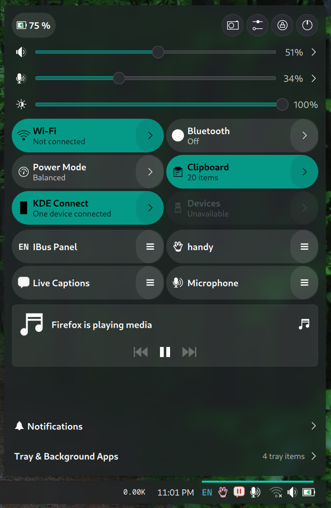

# Quick Settings for KDE Plasma 6

A GNOME-style unified quick settings popup for KDE Plasma 6: one panel icon opens a
single popup with audio/brightness controls, quick toggles, media, notifications,
per-app tray icons and a stock-style keyboard-layout switcher.



## Features

- **Sliders** for output volume, microphone volume and screen brightness, each with a
  quick mute/expand affordance.
- **Quick tiles** for Wi-Fi, Bluetooth, Power Mode, Night Light, dark style, Do Not
  Disturb, Airplane Mode, Clipboard, KDE Connect, Devices and Input Method — each with a
  detail page where it makes sense.
- **Media card** (MPRIS) with artwork, title, artist and previous/play-pause/next
  controls. It can sit at the top, under the header, or below the tile rows.
- **System tray integration**: each StatusNotifierItem can appear as its own clickable
  panel icon and/or as a pill inside the popup. Left click activates, right click (or
  left click on menu-only items) opens the app's native menu.
- **Notifications**: an unread counter and history page, plus stock-style screen toasts
  (one borderless window per notification, timeout bar, hover pause, actions).
- **Keyboard layout**: the stock keyboard-layout face as a panel icon and/or a popup
  pill. Display styles 0/1/2 (name, flag, flag with name badge), wheel switching, and a
  native layout menu with flags, long names and a checkmark on the current layout.
- **Battery pill** with charge state, percentage and a battery detail page.
- **Header buttons** for screenshots (full screen / region / window), System Settings,
  lock screen and the session menu.
- **Configurable** from the widget's settings: choose panel icons, popup contents, tray
  items, keyboard-layout placement/style, media position and screenshot backend.

## Requirements

- **KDE Plasma 6** (declared minimum 6.0; developed and tested on Plasma 6.7.5 on
  Fedora 44).
- `plasma-workspace` and `plasma-desktop` – the applet reuses their public/private QML
  modules (`KeyboardLayout`, `StatusNotifierModel`, battery, clipboard, etc.).

Most features are optional and degrade gracefully when their service is absent. For the
full experience you will want:

| Feature | Provides |
|---|---|
| NetworkManager | Wi-Fi list/connect (`nmcli`) |
| PipeWire + WirePlumber (or PulseAudio) | volume and microphone (`wpctl` / `pactl`) |
| UPower | battery pill and detail page |
| BlueZ + plasma bluetooth module | Bluetooth tile/devices |
| power-profiles-daemon | Power Mode tile |
| KDE Connect | KDE Connect tile |
| `systemd` (`busctl`), `rfkill`, KConfig tools, `plasma-apply-colorscheme` | Night Color, Airplane Mode, color style |
| `spectacle`, `grim` + `slurp`, `flameshot`, `gnome-screenshot` or `maim` | screenshot button |

## Install

No compilation and no installer script are needed: a Plasma widget is just a directory
containing `metadata.json` and `contents/`. Choose one of these two methods.

### Method 1 — use the ready-made `.plasmoid` (easiest)

1. Download `quicksettings-v0.12.9.plasmoid` from the
   **[v0.12.9 release](https://github.com/butter-fly04/plasma-quick-settings/releases/tag/v0.12.9)**
   or from **[dist/quicksettings-v0.12.9.plasmoid](dist/quicksettings-v0.12.9.plasmoid)**.
2. Right-click the desktop or panel → **Enter Edit Mode** → **Add Widgets** →
   **Get New Widgets** → **Install Widget From Local File…**, and select the
   `.plasmoid` file.
3. Search for **Quick Settings** in **Add Widgets** and drag it onto the panel.

### Method 2 — put the folder in your home directory

Extract the repository (or the downloaded ZIP), then copy it into Plasma's user widget
directory so that the installed folder contains `metadata.json` and `contents/`:

```sh
mkdir -p ~/.local/share/plasma/plasmoids/org.community.quicksettings
cp -r contents metadata.json ~/.local/share/plasma/plasmoids/org.community.quicksettings/
```

Then add **Quick Settings** from **Enter Edit Mode → Add Widgets**. If it does not appear
yet, restart Plasma or log out and back in:

```sh
systemctl --user restart plasma-plasmashell
```

On systems without the systemd user service:

```sh
kquitapp6 plasmashell && kstart plasmashell
```

### Update

Use **Install Widget From Local File…** with the newer `.plasmoid`, or replace the folder
in `~/.local/share/plasma/plasmoids/org.community.quicksettings/` with the newer copy.
Restart Plasma or log out/in afterwards.

### Uninstall

Remove the widget from the panel, then delete the folder:

```sh
rm -rf ~/.local/share/plasma/plasmoids/org.community.quicksettings
```

Restart Plasma or log out/in.

## Configuration

Right-click the panel icon (or the widget) → **Configure Quick Settings…**. The settings
are split into four tabs:

- **Panel Icons** — battery, network, volume, microphone and camera indicators, plus the
  per-app tray icons shown next to the Quick Settings buttons.
- **Popup Contents** — which sliders, tiles, header buttons and footer entries appear;
  media-card position; tray-pill list; notification toasts.
- **Keyboard Layout** — show the layout indicator in the panel and/or in the popup, and
  choose the stock display style (name / flag / flag with badge).
- **Screenshot** — screenshot backend and the default mode used by the header button.

The popup is resizable: drag its edges away from the panel, and the tile grid reflows.


## Repository layout

```
contents/
  config/            KConfigXT settings and configuration-page registration
  scripts/qs.sh      system helper (D-Bus, NetworkManager, PipeWire, screenshots, …)
  ui/                QML: popup, panel representation, tiles, pages, backends
docs/                screenshots used by this README
dist/                ready-to-install .plasmoid package
metadata.json        Plasma package metadata
WORKLOG.md           development log and verified behaviour per release
TARGETS.md           requested features and their status
PLAN.md              original design notes
```

## Development

The applet is plain QML on top of Plasma 6 modules; there is no build step.

- Edit files under `contents/`.
- Test the popup with `plasmoidviewer -a org.community.quicksettings`.
  Real panel behaviour (tooltips, popup stacking, notification ownership) must be tested
  in a running plasmashell.
- The downloadable `.plasmoid` is just a zip of `metadata.json` and `contents/`; rebuild
  it with `zip -qr dist/quicksettings-v0.12.9.plasmoid metadata.json contents` after
  changes if you want to publish an updated package.
- Releases are tagged `vX.Y.Z`; see `WORKLOG.md` for the change history and
  `TARGETS.md` for the feature status.

If you install by copying files while developing, remember to restart plasmashell after
changes.

## License

This project is licensed under the **GNU General Public License, version 2 ** — `GPL-2.0-or-later`. See [LICENSE](LICENSE).

It reuses and adapts components and reference implementations from KDE Plasma
(`plasma-workspace`, `plasma-desktop`) and from
[butter-fly04/plasma-unified-quicksettings](https://github.com/butter-fly04/plasma-unified-quicksettings),
all of which are distributed under GPL-2.0-or-later. SPDX headers in the source files
record the same license.

## Credits

- The KDE Plasma developers, for Plasma, its QML components and the stock applets this
  widget follows (system tray, keyboard layout, battery, notifications).
- [butter-fly04/plasma-unified-quicksettings](https://github.com/butter-fly04/plasma-unified-quicksettings)
  for the original unified quick-settings plasmoid this project grew out of.
- Everyone who tested iterations in a real Plasma session.
